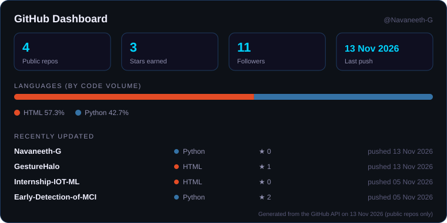

  

  

  
  
  

---

**B.Tech CS (Data Science)** · St. Thomas College of Engineering & Technology, Kannur · Graduating 2027  
Co-author of a paper presented at RAET'26 (MCI detection) · Edge IoT & Smart Automation intern (IEEE SB GCEK) · DEKATHON 4.0 participant

---

### 🚀 Projects

**GestureHalo**: recognises idle, wave and circle from a phone's accelerometer. A small Edge Impulse model runs in the browser as WebAssembly.  
- 98.73% per-window accuracy on 15 held-out recordings (one person, one phone)  
- Edge Impulse · WebAssembly · Firebase Hosting

  
  

---

### 🔬 Research

**Early Detection of MCI: Stacked CNN Feature Fusion**  
- Team paper presented at **RAET'26** (March 2026)  
- ResNet50 + DenseNet121 · Streamlit · TensorFlow  
- Pipeline code only: ADNI data and trained weights are not included

  

---

### 🛠️ In Progress

- **AQUASIFT**: AI-based floating waste detection and selective collection (final-year project, team of four)

---

### 🧰 Tech Stack

<b>Languages</b> 

<b>Machine Learning &amp; Edge</b> 

<b>Web &amp; Cloud</b> 

<b>Tools</b> 

---

### 📊 GitHub Dashboard

  

---

  <strong>Open to data and ML internships.</strong>

  

